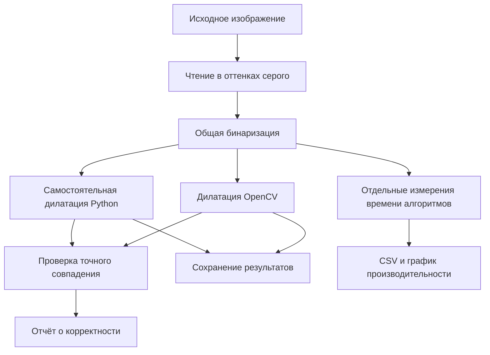

# Лабораторная работа № 1. Вариант 6 — дилатация 3×3

## Архитектура и техническое описание реализации

**Язык:** Python 3.11 или новее.  
**Реализации:** самостоятельная на Python и библиотечная на OpenCV (также Python).  
**Формат итогового отчёта:** `README.md` в репозитории GitHub.

> **Основание:** задание ЛР1, вариант 6: «Дилатация, примитив размера 3 на 3, бинаризацию можно не реализовывать вручную». Общие требования задания: реализовать алгоритм с помощью библиотеки и самостоятельно, сравнить быстродействие и оформить отчёт с исходным кодом на GitHub.
>
> 
> **Статус документа:** проектное описание. Код, испытания и результаты измерений ещё не выполнены; приведённые ниже решения — предлагаемый способ реализации, а не дополнительные требования преподавателя.

## 1. Цель и границы проекта

Цель — реализовать математическую морфологическую операцию **дилатации** для бинарного изображения двумя способами и сравнить их работу на одинаковых данных.

В рамках проекта необходимо:

1. Загрузить изображение и перевести его в бинарный вид средствами OpenCV.
2. Реализовать дилатацию с квадратным структурирующим элементом 3×3 **самостоятельно на Python**.
3. Реализовать ту же операцию вызовом **`cv2.dilate`**.
4. Проверить полное совпадение выходных изображений, включая граничные пиксели.
5. Измерить время вычисления двух реализаций на входах разных размеров.
6. Сохранить изображения, таблицу измерений, график и описать результаты в `README.md`.

**Не требуется:** писать собственную бинаризацию, использовать C++, создавать графический интерфейс, применять GPU, реализовывать другие варианты лабораторной работы, оптимизировать самостоятельную реализацию до уровня OpenCV.

## 2. Теоретическая основа

### 2.1. Что делает дилатация

Дилатация расширяет белые области бинарного изображения, рассматриваемые как объекты (передний план). Для каждого пикселя вычисляется максимум по окрестности, заданной структурирующим элементом. Если в окрестности 3×3 находится хотя бы один белый пиксель, результирующий пиксель становится белым.

Обозначим бинарное изображение через \(I\), а результат через \(D\). Для координат \((x,y)\):

\[
D(x,y)=\max_{\Delta x,\Delta y\in\{-1,0,1\}}
I(x+\Delta x,y+\Delta y).
\]

Пиксели за пределами изображения считаются равными 0. Для бинарного случая это эквивалентно логическому «ИЛИ» по девяти позициям.

### 2.2. Структурирующий элемент

Используется неизменяемая матрица:

```text
1 1 1
1 1 1
1 1 1
```

Якорная позиция — центральный элемент (1, 1). Применяется **ровно одна итерация** дилатации. Все девять элементов активны, включая диагональные соседние пиксели.

### 2.3. Пример на небольшом изображении

Входное изображение 5×5 (1 — белый пиксель, 0 — чёрный):

```text
0 0 0 0 0
0 0 0 0 0
0 0 1 0 0
0 0 0 0 0
0 0 0 0 0
```

Результат дилатации 3×3:

```text
0 0 0 0 0
0 1 1 1 0
0 1 1 1 0
0 1 1 1 0
0 0 0 0 0
```

Реально значения хранятся не как 0 и 1, а как **0 и 255**.

## 3. Единые правила обработки изображений

Без одинаковых параметров две реализации нельзя корректно сравнивать.

| Параметр | Принятое решение |
|---|---|
| Представление изображения | Двумерный массив `numpy.ndarray` |
| Тип элементов | `np.uint8` |
| Значения пикселей | Только `0` (фон) и `255` (объект) |
| Загрузка изображения | `cv2.imread(path, cv2.IMREAD_GRAYSCALE)` |
| Бинаризация | `cv2.threshold(gray, threshold, 255, cv2.THRESH_BINARY)` |
| Порог по умолчанию | `127`; белым становится пиксель со значением **строго больше** порога |
| Структурирующий элемент | Все единицы, размер 3×3 |
| Количество проходов | 1 |
| Якорь | Центр 3×3 |
| Обработка границ | Константное дополнение нулями: за изображением значение `0` |
| Изменение входных данных | Не допускается: каждая реализация возвращает новый массив |
| Формат сохраняемых изображений | PNG, без потерь |

**Важно:** OpenCV используется для чтения файлов, бинаризации и записи результатов в обоих вариантах. Это допускается условием задания: самостоятельно требуется реализовать именно **дилатацию**, а не все вспомогательные этапы. Внутри собственной функции дилатации запрещено использовать `cv2.dilate`, `cv2.morphologyEx`, свёртки и готовые операции расширения областей.

## 4. Архитектура проекта

Рекомендуется небольшая модульная структура без классов, где достаточно обычных функций.

```text
lr1-dilation/
├── README.md                      # итоговый отчёт, инструкция запуска
├── pyproject.toml                 # зависимости, настройки проекта
├── src/
│   └── dilation_lab/
│       ├── __init__.py
│       ├── __main__.py             # входная точка: python -m dilation_lab
│       ├── io_utils.py            # загрузка, бинаризация, сохранение
│       ├── dilation.py            # две реализации алгоритма
│       ├── validation.py          # сравнение результатов
│       ├── benchmark.py           # измерение времени, экспорт CSV
│       └── visualization.py       # сравнение изображений, график
├── tests/
│   └── test_dilation.py           # автоматические тесты
├── data/
│   └── example.png                # исходное изображение для демонстрации
└── results/                       # получаемые файлы, при необходимости
    ├── input_binary.png
    ├── dilated_python.png
    ├── dilated_opencv.png
    ├── difference.png
    ├── comparison.png
    ├── benchmark.csv
    └── benchmark.png
```

Разделение на модули помогает независимо тестировать алгоритм, проводить измерения и строить отчёт. Хранение результатов в отдельном каталоге исключает перезапись исходного изображения.

### 4.1. Схема потока данных



**Примечание:** блок измерений использует те же функции дилатации на уже подготовленных бинарных массивах. Чтение файлов, преобразование цвета, бинаризация, сохранение и построение графиков **не входят** в измеряемый интервал.

## 5. Контракты модулей и деталей реализации

### 5.1. `io_utils.py`: ввод и предобработка

Предлагаемые функции:

```python
def load_grayscale(path: str) -> np.ndarray: ...
def binarize(gray: np.ndarray, threshold: int = 127) -> np.ndarray: ...
def save_image(path: str, image: np.ndarray) -> None: ...
```

Последовательность обработки:

1. Прочитать изображение с `cv2.IMREAD_GRAYSCALE`.
2. Проверить, что файл существует и изображение удалось декодировать (`imread` не вернул `None`).
3. Проверить допустимость порога (`0 <= threshold <= 255`).
4. Вызвать один раз `cv2.threshold` и передать **один и тот же** полученный массив двум алгоритмам.
5. Сохранить бинаризованный вход, чтобы результат был воспроизводим.

Содержимое входного файла может быть цветным или чёрно-белым. После предобработки оба алгоритма получают только двумерный бинарный массив.

### 5.2. `dilation.py`: самостоятельная реализация

Интерфейс:

```python
def dilate_python(image: np.ndarray) -> np.ndarray: ...
```

Алгоритм намеренно использует явные циклы Python. Для каждого выходного пикселя проверяются девять соседних позиций; выход равен 255, если хотя бы одна **существующая** позиция белая, иначе 0. Во время чтения окрестности исходный массив не изменяется.

Рекомендуемая реализация:

```python
import numpy as np


def dilate_python(image: np.ndarray) -> np.ndarray:
    height, width = image.shape
    output = np.zeros_like(image)

    for y in range(height):
        for x in range(width):
            found_white = False

            for dy in (-1, 0, 1):
                ny = y + dy
                if not 0 <= ny < height:
                    continue

                for dx in (-1, 0, 1):
                    nx = x + dx
                    if not 0 <= nx < width:
                        continue

                    if image[ny, nx] == 255:
                        found_white = True
                        break

                if found_white:
                    break

            if found_white:
                output[y, x] = 255

    return output
```

Здесь NumPy нужен **только как формат хранения массива**, а сама морфологическая операция вычисляется явными циклами Python. Раннее завершение проверки окрестности не изменяет результат: как только найден белый пиксель, дальнейший поиск не требуется.

### 5.3. `dilation.py`: библиотечная реализация OpenCV

Интерфейс:

```python
def dilate_opencv(image: np.ndarray) -> np.ndarray: ...
```

Рекомендуемая реализация:

```python
import cv2
import numpy as np


KERNEL_3X3 = np.ones((3, 3), dtype=np.uint8)


def dilate_opencv(image: np.ndarray) -> np.ndarray:
    return cv2.dilate(
        image,
        KERNEL_3X3,
        anchor=(1, 1),
        iterations=1,
        borderType=cv2.BORDER_CONSTANT,
        borderValue=0,
    )
```

Нулевое граничное значение указано **явно**, а не оставлено на усмотрение настроек библиотеки. Ядро создаётся **один раз на уровне модуля** (константа `KERNEL_3X3`), а внутри функции вызывается только `cv2.dilate`: подготовка ядра не влияет на измерения. Создание выходного массива остаётся частью измеряемой операции для обеих реализаций.

### 5.4. `validation.py`: сопоставление результатов

```python
def compare_results(python_result: np.ndarray,
                    opencv_result: np.ndarray) -> dict: ...
```

Проверки:

- совпадение формы и типа массивов;
- попиксельное сравнение `np.array_equal`;
- число отличающихся пикселей (`np.count_nonzero(a != b)`);
- максимальная абсолютная разница, вычисленная без переполнения `uint8`;
- изображение различий: 255 там, где результаты не совпали, иначе 0.

**Критерий успеха:** число несовпадающих пикселей **равно нулю**. Даже небольшое расхождение на границе означает ошибку в реализации или различие конфигурации алгоритмов.

### 5.5. `visualization.py`: иллюстрации

Создать два вида материалов:

1. Составное изображение с четырьмя панелями: исходное изображение, бинарный вход, результат Python, результат OpenCV. Для читаемости допускается отдельная панель различий.
2. График времени выполнения в зависимости от числа пикселей для обеих реализаций. Следует использовать одинаковую ось времени и явно подписанные единицы измерения. Если кривые сильно различаются, можно дополнительно построить график коэффициента ускорения.

## 6. Проверка корректности

Автоматические тесты следует выполнять через `pytest`. В каждом случае результат самостоятельной функции сравнивается с OpenCV при **тех же параметрах**.

| Сценарий | Вход | Что проверяется |
|---|---|---|
| Полностью чёрное изображение | Все пиксели 0 | Результат остаётся чёрным |
| Полностью белое изображение | Все пиксели 255 | Результат остаётся белым |
| Одна белая точка в центре | Матрица 5×5 | Образуется квадрат 3×3 |
| Белая точка в углу | Матрица 5×5 | Нет выхода за границы, получается блок 2×2 |
| Белый пиксель на стороне | Матрица 5×5 | Корректная обработка края |
| Диагональные точки | Небольшая маска | Учитываются диагональные соседи |
| Изображение 1×1 | Значение 0 или 255 | Корректная обработка минимального размера |
| Узкая матрица | 1×5 и 5×1 | Нет ошибок индексации |
| Случайные бинарные изображения | Несколько размеров, фиксированный `seed` | Полное совпадение с OpenCV |
| Неизменность входа | Копия входного массива до вызова | Исходная матрица не меняется |

Для случайного теста использовать генератор `np.random.default_rng(42)`, получить бинарную маску, преобразовать её к `uint8` со значениями 0/255. Это делает проверки повторяемыми.

Обязательные утверждения:

```python
assert result_python.dtype == np.uint8
assert result_python.shape == input_image.shape
assert np.array_equal(result_python, result_opencv)
assert np.array_equal(input_image, input_image_before)
```

## 7. Методика сравнения быстродействия

### 7.1. Что именно измеряем

Измеряется **время выполнения одной операции дилатации**, включая создание её выходного массива, но без чтения, бинаризации, проверки корректности, отображения и записи файлов. Обе функции получают один и тот же тип данных (`np.ndarray`, `uint8`) и одинаковый вход.

Временные метки получают через `time.perf_counter_ns()`; разность переводят в миллисекунды:

```python
start = time.perf_counter_ns()
output = dilation_function(binary_image)
elapsed_ms = (time.perf_counter_ns() - start) / 1_000_000
```

Необходимо сохранять возвращённый массив, а не заменять вычисление пустой операцией. Внутри отдельного повторения не должно быть печати в консоль.

### 7.2. Входы для измерений

Для воспроизводимого эксперимента использовать синтетические квадратные бинарные изображения с заполнением белыми пикселями примерно **25%** и фиксированным начальным состоянием генератора случайных чисел. Это обеспечивает сопоставимую структуру данных разных размеров. К исходному изображению из `data/` отдельно применить обе функции для наглядного примера.

Рекомендуемые размеры: **64×64, 128×128, 256×256, 512×512**. Размер 1024×1024 можно добавить, если время исполнения самостоятельной реализации приемлемо.

### 7.3. Повторения и статистика

Для каждого размера и алгоритма:

1. Создать бинарную маску **до начала** измерения.
2. Выполнить 3 предварительных запуска для прогрева (не включать в статистику).
3. Выполнить не менее 15 измеряемых запусков.
4. Рассчитать медиану времени, минимальное время и разброс (например, межквартильный размах).
5. Повторить испытания в одинаковых условиях: на одной машине, без намеренно запущенных тяжёлых фоновых задач.

**Тонкость коротких измерений:** если один вызов OpenCV занимает слишком мало времени для устойчивого измерения, замерять серию из нескольких вызовов одним интервалом и делить время серии на их число. Метод и число вызовов надо указать в отчёте. Сравнение должно проводиться для обеих функций по одному и тому же принципу.

Для базовой воспроизводимости зафиксировать версии Python, OpenCV, NumPy, операционную систему и процессор. Если OpenCV использует несколько потоков, отметить это; при желании зафиксировать `cv2.setNumThreads(1)` и указать настройку в отчёте.

### 7.4. Показатели

- **Медианное время**, мс — основной показатель скорости.
- **Ускорение OpenCV**, раз:

  \[
  S=\frac{T_{\mathrm{Python}}}{T_{\mathrm{OpenCV}}}.
  \]

- **Число несовпадающих пикселей** — показатель корректности (требуется 0).
- **Зависимость времени от размера входа** — помогает показать масштабирование затрат.

Не следует придумывать ожидаемые результаты или заранее записывать значения времени. Скорость OpenCV, вероятно, окажется выше из-за исполнения основного алгоритма в скомпилированном коде, но величина преимущества определяется экспериментом.

### 7.5. Формат `benchmark.csv`

```csv
size,width,height,pixels,algorithm,median_ms,min_ms,iqr_ms,runs
64,64,64,4096,python,,,,15
64,64,64,4096,opencv,,,,15
```

Пустые поля в примере **не являются результатами измерений**: файл следует заполнять фактическими числовыми значениями после запуска. Размеры, количество запусков и состав столбцов должны соответствовать реальным настройкам эксперимента.

## 8. Интерфейс запуска

Графический интерфейс не требуется: достаточно командной строки на стандартном `argparse`.

Предлагаемые команды после установки проекта:

```bash
# Подготовка примера, две дилатации, проверка, сохранение изображений
python -m dilation_lab run \
  --input data/example.png \
  --output-dir results/demo \
  --threshold 127

# Измерение скорости на синтетических масках
python -m dilation_lab benchmark \
  --sizes 64 128 256 512 \
  --runs 15 \
  --warmups 3 \
  --output-dir results/benchmark

# Проверка корректности
pytest -q
```

Это **проектируемый интерфейс**: приведённые команды начнут работать после реализации указанных модулей и входной точки `__main__.py`.

Поведение команды `run`:

- выдаёт понятное сообщение, если изображение не найдено;
- сохраняет бинарное изображение и выходы обеих реализаций;
- записывает маску отличий и выводит число несовпадающих пикселей;
- завершается с ненулевым кодом, если реализации дали разные результаты.

Поведение команды `benchmark`:

- генерирует воспроизводимые маски;
- отдельно запускает оба алгоритма и сохраняет численные измерения в CSV;
- строит график в PNG;
- не включает построение графиков в измеряемое время.

## 9. Зависимости и воспроизводимость

Минимальные зависимости:

- `numpy` — хранение бинарных изображений;
- `opencv-python` — чтение, бинаризация и библиотечная дилатация;
- `matplotlib` — визуализация результатов измерений;
- `pytest` — автоматические тесты.

Для простоты достаточно стандартного `pyproject.toml` и установки в виртуальную среду. Точные версии зависимостей нужно зафиксировать в репозитории и отчёте **после** выбора и проверки рабочего окружения. Для изоляции эксперимента желательно не менять версии библиотек между измерениями.

## 10. Требования к итоговому `README.md`

Задание требует, чтобы репозиторий GitHub содержал исходный код и отчёт со следующими разделами:

1. **Теоретическая база.** Определение дилатации, элемент 3×3, формула, объяснение обработки границ.
2. **Описание разработанной системы.** Структура проекта, схема обработки, различия собственной и библиотечной реализаций, способ запуска.
3. **Результаты работы и тестирования системы.** Исходные и полученные изображения, подтверждение совпадения пикселей, таблица измерений, графики, наблюдаемые закономерности.
4. **Выводы по работе.** Корректность двух подходов, реальные результаты быстродействия, объяснение причин различий и ограничения сравнения.
5. **Использованные источники.** Задание, документация OpenCV, документация Python и другие фактически использованные материалы.

Не включать в готовый отчёт значения времени, пока они не получены в ходе эксперимента. В выводах отдельно отметить, что сравниваются **чистые циклы интерпретируемого Python** и **оптимизированная библиотечная реализация**, а не только два математически различных алгоритма.

## 11. Критерии готовности

Работа считается технически законченной, когда:

- [ ] Самостоятельный алгоритм действительно выполняется циклами Python, без вызова готовой морфологической операции.
- [ ] Обе реализации используют одно ядро 3×3 по смыслу, одинаковые границы и один проход.
- [ ] Все тестовые изображения проходят попиксельную проверку.
- [ ] Входные массивы не изменяются.
- [ ] Можно запустить обработку пользовательского изображения из командной строки.
- [ ] Сохранены исходное бинарное изображение, оба результата и маска различий.
- [ ] Измерения повторяемы, сохранены в CSV и представлены графиком.
- [ ] В GitHub размещены код и `README.md` с пятью требуемыми разделами.

## 12. Предлагаемый порядок разработки

1. Создать структуру проекта, зависимости и загрузку/бинаризацию.
2. Написать самостоятельную дилатацию и покрыть её небольшими ручными тестами.
3. Добавить `cv2.dilate` с явно заданными параметрами.
4. Реализовать автоматическую проверку эквивалентности на краях и случайных масках.
5. Сделать обработку пользовательского изображения и экспорт иллюстраций.
6. Подготовить измерения, CSV и график.
7. Оформить и проверить `README.md` по требованиям ЛР.

## 13. Источники для реализации

1. **ЛР1.** Задание, вариант 6 — предоставленный PDF `LW1.pdf`.
2. **OpenCV. Morphological Transformations.** https://docs.opencv.org/4.x/d9/d61/tutorial_py_morphological_ops.html — описание морфологических операций и примеры дилатации.
3. **OpenCV. Image Filtering (`dilate`).** https://docs.opencv.org/4.x/d4/d86/group__imgproc__filter.html — параметры функции, в том числе `anchor`, `iterations`, `borderType`, `borderValue`.
4. **Python. `time.perf_counter_ns()`.** https://docs.python.org/3/library/time.html#time.perf_counter_ns — высокоточный счётчик для измерений.

---

**Результат проектирования:** компактное приложение на Python с двумя заменяемыми реализациями одной операции, общим входом, автоматической проверкой совпадения и воспроизводимыми замерами. Бинаризация выполняется OpenCV и не входит в самостоятельную часть задания.
