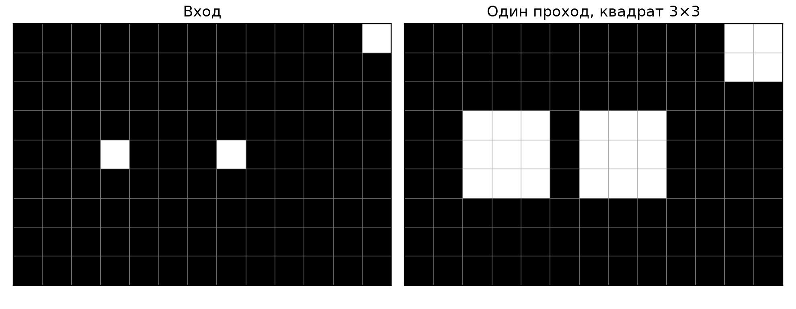
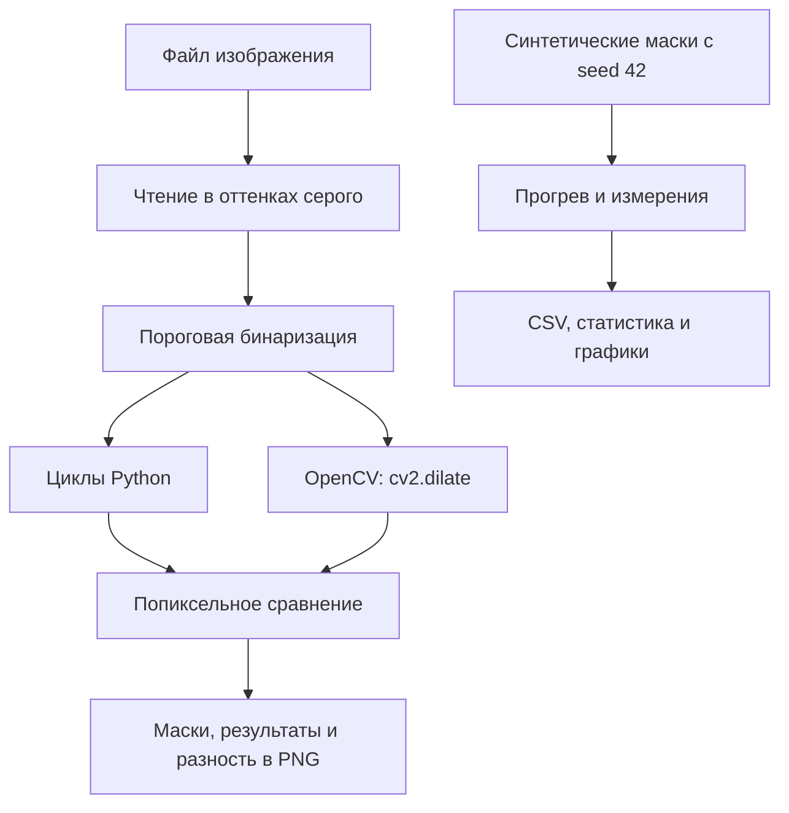
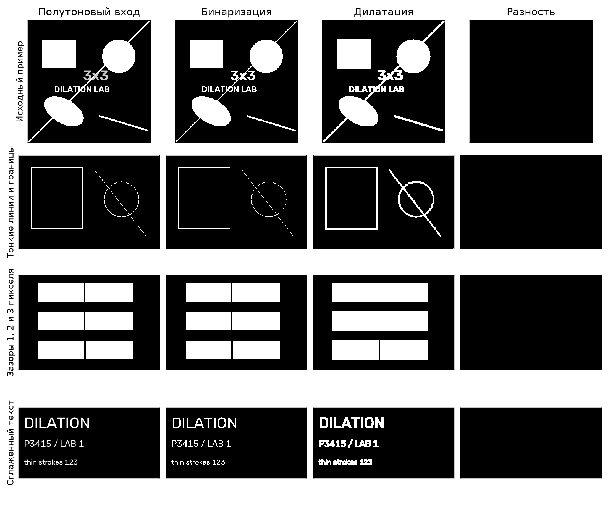
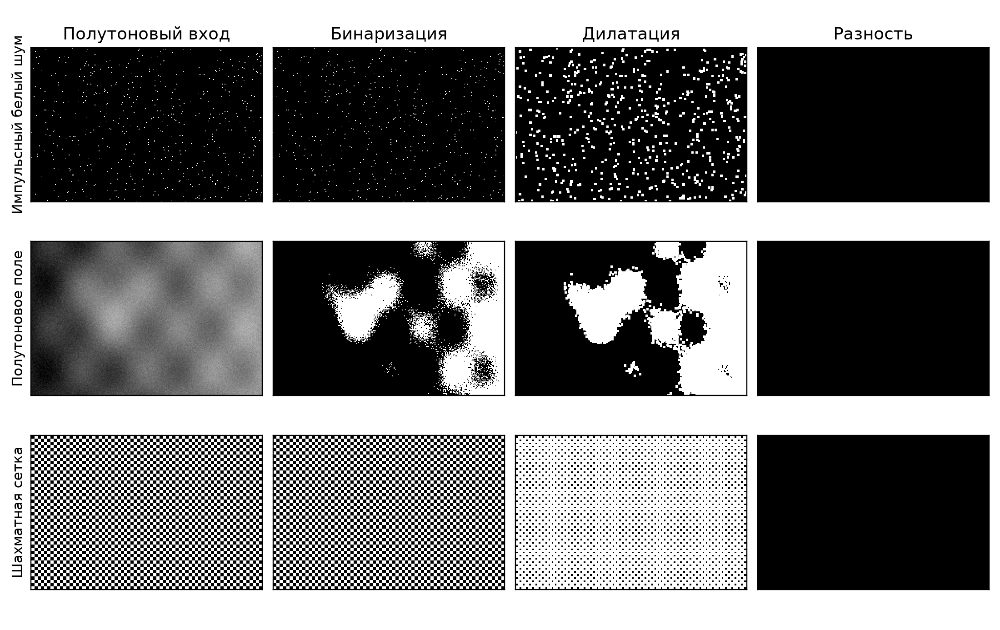
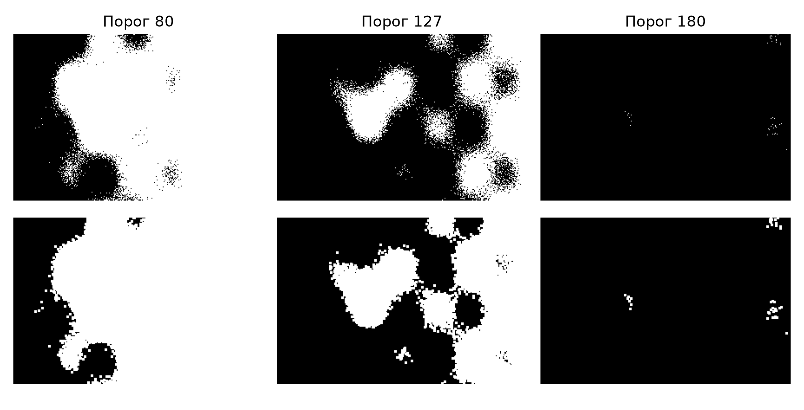
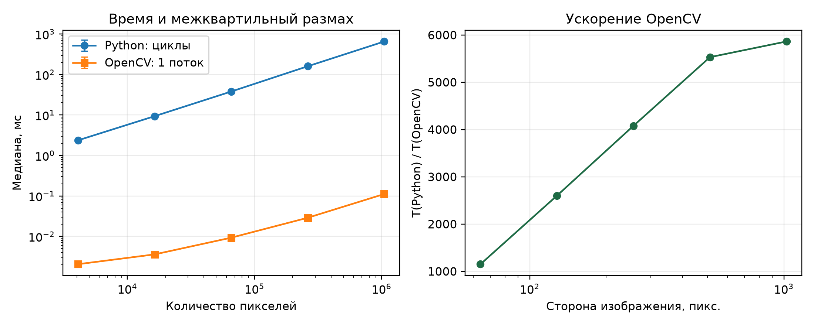
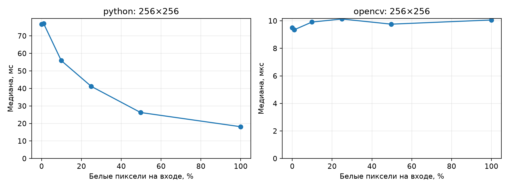

# Лабораторная работа № 1. Дилатация 3×3

**Предмет:** Системы компьютерной обработки изображений  
**Выполнил:** Козлов Василий Сергеевич  
**Группа:** P3415  
**Вариант:** 6  
**Дата проверки и экспериментов:** 30.10.2026

**Цель работы:** реализовать простой алгоритм обработки изображений самостоятельно и с помощью библиотеки, проверить эквивалентность результатов и сравнить быстродействие.

Согласно [заданию](TASK.md), необходимо выполнить дилатацию со структурирующим элементом 3×3. Самостоятельная бинаризация не требуется. Разработаны две реализации: явные циклы Python и вызов OpenCV. При проверке пройден **61 автоматический тест**, а на семи демонстрационных изображениях проверены **588 160 выходных пикселей без единого расхождения**.

## 1. Теоретическая база

### 1.1. Определение дилатации

Дилатация — операция математической морфологии, расширяющая множество пикселей переднего плана. В данной работе передний план белый, его значение равно 255; фон чёрный, со значением 0. Пиксель результата становится белым, если хотя бы одна активная позиция структурирующего элемента попадает на белый пиксель входа. Такое определение и примеры применения приведены в [документации OpenCV](https://docs.opencv.org/4.x/d9/d61/tutorial_py_morphological_ops.html).

Для бинарного изображения $I$ результат одного прохода:

$$
D(x,y)=\max_{\Delta x,\Delta y\in\{-1,0,1\}}
\widetilde I(x+\Delta x,y+\Delta y),
$$

где $\widetilde I$ совпадает с $I$ внутри изображения и равна нулю за его границами. Для множества белых пикселей $A$ и симметричного квадратного элемента $B$ это соответствует сумме Минковского $A\oplus B$ с обрезкой по размеру кадра.

Используется полный квадрат, включая диагональные позиции:

```text
1 1 1
1 1 1    якорь: центральный элемент (1, 1)
1 1 1
```

Это отличается от крестообразного элемента: белая точка расширяется во все восемь направлений. Для бинарных значений максимум эквивалентен логическому «ИЛИ» по окрестности.

### 1.2. Границы, бинаризация и число проходов

Приняты одинаковые правила для обеих реализаций:

- вход дилатации — непустой двумерный массив `np.uint8` со значениями 0 и 255;
- размер результата совпадает с размером входа;
- за границей кадра находится чёрный фон — постоянное нулевое дополнение;
- выполняется **ровно один проход**; вычисленные пиксели не используются для обработки соседей в этом же проходе;
- результат записывается в новый массив, вход не изменяется.

Одиночная точка внутри кадра превращается в квадрат 3×3 из девяти пикселей. Точка на стороне даёт шесть белых пикселей, а в углу — четыре. Вырожденные размеры 1×1, 1×N и N×1 обрабатываются по тем же правилам.



На рисунке каждая клетка соответствует одному пикселю. Точка в правом верхнем углу расширяется только внутрь кадра; две внутренние точки образуют квадраты 3×3. Чёрный столбец между ними сохраняется.

Перед дилатацией исходный файл читается в оттенках серого и бинаризуется:

$$
I(x,y)=
\begin{cases}
255,&G(x,y)>T,\\
0,&G(x,y)\leq T.
\end{cases}
$$

По умолчанию $T=127$. Значение, равное порогу, относится к фону. Обработка чёрного текста на белом фоне без инверсии будет расширять белый фон; для утолщения самих символов требуется заранее выбрать правильную полярность маски.

### 1.3. Свойства и вычислительная сложность

Поскольку центр входит в структурирующий элемент, выполняется экстенсивность: $I\leq D(I)$. Белые пиксели после обработки не исчезают. Операция также монотонна: из $I\leq J$ следует $D(I)\leq D(J)$, и сохраняет объединение: $D(I\cup J)=D(I)\cup D(J)$. Эти свойства включены в автоматические проверки.

Дилатация в общем случае **не идемпотентна**: второй проход продолжает расширение. Например, внутренняя точка после одного прохода даёт 9 белых пикселей, после двух — 25.

Самостоятельная реализация обходит все $W\cdot H$ пикселей и просматривает до девяти соседей для каждого. Для фиксированного ядра время составляет $\Theta(WH)$, дополнительная память под результат — $\Theta(WH)$. Ранний выход при обнаружении белого соседа меняет константу времени в зависимости от содержимого изображения.

Дилатация полезна для утолщения линий и соединения близких фрагментов. При этом она увеличивает белый импульсный шум и может объединять разные объекты. Поэтому одна дилатация не является универсальным способом удаления шума.

## 2. Описание разработанной системы

### 2.1. Архитектура

Приложение имеет консольный интерфейс и функциональную модульную архитектуру. Обе реализации получают один и тот же бинарный массив. NumPy в самостоятельном алгоритме используется только для хранения и создания массивов; вычисление дилатации выполняется циклами Python.



| Файл | Назначение |
|---|---|
| [`src/dilation_lab/dilation.py`](src/dilation_lab/dilation.py) | Самостоятельная и библиотечная дилатация |
| [`src/dilation_lab/io_utils.py`](src/dilation_lab/io_utils.py) | Чтение, бинаризация, сохранение |
| [`src/dilation_lab/validation.py`](src/dilation_lab/validation.py) | Число различающихся пикселей, максимальная разность и её маска |
| [`src/dilation_lab/benchmark.py`](src/dilation_lab/benchmark.py) | Базовый замер скорости и экспорт CSV |
| [`src/dilation_lab/visualization.py`](src/dilation_lab/visualization.py) | Составные изображения и графики консольных команд |
| [`src/dilation_lab/__main__.py`](src/dilation_lab/__main__.py) | Команды `run` и `benchmark`, обработка аргументов |
| [`tests/test_dilation.py`](tests/test_dilation.py) | Исходные 34 тестовых случая |
| [`tests/test_extended.py`](tests/test_extended.py) | 27 дополнительных случаев: независимый эталон, свойства, ввод-вывод и CLI |
| [`scripts/verify_lab.py`](scripts/verify_lab.py) | Генерация шести дополнительных изображений и расширенный эксперимент отчёта |
| [`results/verification/`](results/verification/) | Актуальные изображения, метрики, исходные измерения и протокол тестов |

Классы для обработки изображений не требуются. `BenchmarkResult` в базовом модуле измерений — неизменяемая структура данных со статистикой одного алгоритма на одном размере.

### 2.2. Самостоятельный алгоритм

Функция `dilate_python` создаёт нулевой выходной массив и последовательно обрабатывает каждую позицию `(y, x)`:

1. Перебирает смещения `dy` и `dx` от −1 до 1.
2. Пропускает координаты за пределами изображения.
3. Проверяет, равен ли существующий сосед 255.
4. При обнаружении белого соседа записывает 255 в выходную позицию и завершает просмотр этой окрестности.
5. Если белых соседей нет, выходная позиция остаётся нулевой.

Здесь не вызываются готовые морфологические операции, свёртки или векторизованные фильтры. Результат формируется отдельно от входа, что исключает каскадное расширение в пределах одного прохода.

### 2.3. Библиотечный алгоритм

Функция `dilate_opencv` использует ядро, созданное один раз на уровне модуля:

```python
KERNEL_3X3 = np.ones((3, 3), dtype=np.uint8)

return cv2.dilate(
    image,
    KERNEL_3X3,
    anchor=(1, 1),
    iterations=1,
    borderType=cv2.BORDER_CONSTANT,
    borderValue=0,
)
```

Параметры функции описаны в [справочнике OpenCV](https://docs.opencv.org/4.x/d4/d86/group__imgproc__filter.html). Явное указание якоря, границы и числа итераций обеспечивает совпадение постановки задачи с самостоятельной реализацией.

### 2.4. Проверка и интерфейс

`compare_results` проверяет форму и тип массивов, считает несовпадающие пиксели и создаёт маску: 255 там, где результаты различаются, 0 — где совпадают. Максимальная абсолютная разность вычисляется после преобразования `uint8` в `int16`, чтобы избежать переполнения при вычитании `0 − 255`.

Команда `run` сохраняет `input_binary.png`, `dilated_python.png`, `dilated_opencv.png`, `difference.png` и `comparison.png`. При несовпадении результатов возвращается ненулевой код. Отсутствующий файл, недекодируемое изображение и порог вне диапазона 0…255 также приводят к сообщению об ошибке.

### 2.5. Установка и воспроизведение

Для воспроизведения проверенного окружения используется Python 3.12. Прямые зависимости зафиксированы в [`requirements-verified.txt`](requirements-verified.txt).

```bash
python3.12 -m venv .venv
.venv/bin/python -m pip install -r requirements-verified.txt
.venv/bin/python -m pip install -e . --no-deps

# Обработка отдельного изображения
.venv/bin/python -m dilation_lab run \
  --input data/example.png \
  --output-dir results/demo \
  --threshold 127

# Автоматические тесты
.venv/bin/python -m pytest -q

# Все изображения, проверки и измерения данного отчёта
.venv/bin/python scripts/verify_lab.py
```

Отдельно доступна исходная команда сравнения быстродействия:

```bash
.venv/bin/python -m dilation_lab benchmark \
  --sizes 64 128 256 512 1024 \
  --runs 15 --warmups 3 \
  --output-dir results/benchmark
```

У неё базовая методика с пакетами по 5 вызовов. **Таблицы и графики ниже получены расширенным скриптом `scripts/verify_lab.py`**, который отключает параллельные области OpenCV, подбирает число вызовов в интервале отдельно для каждого алгоритма и сохраняет все исходные замеры. Файлы в `results/benchmark/` относятся к прежнему эксперименту и в численные выводы этого отчёта не входят.

## 3. Результаты работы и тестирования системы

### 3.1. Проверка выполнения задания

| Требование | Результат проверки |
|---|---|
| Нативная реализация на Python | Дилатация вычисляется явными циклами без готовых фильтров |
| Библиотечная реализация | Используется `cv2.dilate` |
| Структурирующий элемент 3×3 | Полный квадрат, центральный якорь, один проход |
| Одинаковая обработка границ | Нулевое дополнение у обеих реализаций |
| Сравнение результатов | Ноль различий на семи изображениях и в дополнительных проверках |
| Сравнение быстродействия | Новые замеры на пяти размерах, CSV и графики |
| Отчёт с пятью разделами | Представлен в этом README; код и результаты находятся в каталоге лабораторной |

Ошибок вычисления дилатации в проверенной области входных данных не обнаружено. Для расширения проверки добавлены тесты и экспериментальный скрипт; исходные функции дилатации не изменялись. В отчёте используются новые измерения, а объяснение выигрыша скорости не связывается с неподтверждённым числом рабочих потоков.

### 3.2. Набор изображений и точность

Помимо первоначального примера созданы **шесть дополнительных изображений**. Они генерируются локально из геометрических примитивов, текста и аналитических полей; фотографий и внешних наборов данных в этом эксперименте нет. Для случайных составляющих используется `seed=42`.

| Изображение | Размер, W×H | Что проверяет | Исходный файл |
|---|---:|---|---|
| Исходный пример | 512×512 | Фигуры, надписи, линии | [`example.png`](data/example.png) |
| Тонкие линии и границы | 288×192 | Утолщение, диагонали, обрезку на краю | [`thin_lines.png`](data/test_images/thin_lines.png) |
| Зазоры | 216×144 | Слияние объектов при расстояниях 1, 2 и 3 пикселя | [`gaps.png`](data/test_images/gaps.png) |
| Сглаженный текст | 384×192 | Бинаризацию полутоновых краёв и слияние символов | [`text.png`](data/test_images/text.png) |
| Белый импульсный шум | 288×192 | Поведение разреженных случайных точек | [`noise.png`](data/test_images/noise.png) |
| Полутоновое поле | 288×192 | Градиент, локальные максимумы, периодические детали и шум | [`grayscale.png`](data/test_images/grayscale.png) |
| Шахматная сетка, клетки 4×4 | 288×192 | Плотную повторяющуюся структуру | [`checkerboard.png`](data/test_images/checkerboard.png) |

Во всех семи случаях порог равен 127. В таблице ниже площадь — число белых пикселей; компоненты считаются с **8-связностью**, то есть с учётом диагональных соседей.

| Изображение | Площадь до | Площадь после | Компоненты до → после | Несовпадения Python / OpenCV |
|---|---:|---:|---:|---:|
| Исходный пример | 54 980 | 60 128 | 12 → 10 | 0 |
| Тонкие линии и границы | 1 085 | 3 331 | 4 → 4 | 0 |
| Зазоры | 12 012 | 13 200 | 6 → 4 | 0 |
| Текст | 3 238 | 6 043 | 32 → 17 | 0 |
| Шум | 582 | 4 972 | 560 → 434 | 0 |
| Полутоновое поле | 15 940 | 22 266 | 380 → 29 | 0 |
| Шахматная сетка | 27 648 | 48 142 | 1 → 1 | 0 |

Для каждого изображения максимальная абсолютная разность также равна **0**. Полные данные и контрольные суммы входных массивов находятся в [`image_metrics.csv`](results/verification/image_metrics.csv).

На рисунках столбцы показывают исходное изображение в оттенках серого, бинарный вход, результат дилатации и маску несовпадений. Результаты Python и OpenCV идентичны, поэтому показан один общий результат; отдельные файлы обеих реализаций сохранены в [каталоге изображений](results/verification/images/).





**Наблюдаемые закономерности:**

- Тонкие линии утолщаются; число белых пикселей в соответствующем примере увеличивается примерно в 3,07 раза.
- В примере с прямоугольниками зазоры шириной 1 и 2 пикселя закрываются полностью. От зазора шириной 3 пикселя остаётся один чёрный столбец. Поэтому число компонент уменьшается с 6 до 4.
- У текста площадь возрастает в 1,87 раза, а число компонент уменьшается с 32 до 17: соседние части букв и символы могут сливаться.
- Белый шум расширяется: площадь увеличивается с 582 до 4 972 пикселей, в 8,54 раза. Значение меньше девяти из-за перекрытий окрестностей и обрезки на границах.
- У шахматной сетки число 8-связных компонент уже на входе равно одному: соседние белые клетки соприкасаются по диагонали. После дилатации фон сокращается, но число компонент остаётся прежним.

### 3.3. Влияние порога бинаризации

Для одного и того же полутонового поля дополнительно проверены пороги 80, 127 и 180. Верхний ряд — бинаризация, нижний — дилатация.



| Порог | Белые пиксели до, % | Белые пиксели после, % |
|---:|---:|---:|
| 80 | 71,649 | 76,336 |
| 127 | 28,827 | 40,267 |
| 180 | 0,072 | 0,535 |

При повышении порога передний план становится разреженнее, поэтому меняется и результат морфологической обработки. Дилатация расширяет полученную маску, но не восстанавливает информацию, отброшенную при бинаризации. На всех трёх порогах реализации совпали. Численные данные сохранены в [`threshold_metrics.csv`](results/verification/threshold_metrics.csv).

### 3.4. Автоматические тесты

Фактический результат запуска:

```text
$ .venv/bin/python -m pytest -q
61 passed in 16.80s
```

[Сохранённый протокол pytest](results/verification/pytest.txt).

Исходные 34 случая проверяют чёрные и белые маски, одиночные точки, диагонали, вырожденные размеры, случайные входы, неизменность данных, сравнение массивов и пороговую бинаризацию. Ещё 27 случаев усиливают проверку:

| Группа дополнительных проверок | Проверяемое свойство |
|---|---|
| Все $2^9=512$ бинарных масок 3×3 для каждой реализации | Совпадение с независимым эталоном на всех таких входах |
| Все четыре угла | Правильное нулевое дополнение и отсутствие выхода за границы |
| Один и два прохода | После внутренней точки получаются соответственно 9 и 25 пикселей |
| Прямоугольники, строки, столбцы | Корректность при неквадратной форме |
| Транспонированные и срезанные массивы, обратный порядок столбцов | Независимость результата от расположения данных в памяти |
| Разные плотности переднего плана | Экстенсивность, монотонность, сохранение объединения |
| Загрузка цветного PNG с кириллицей в пути | Чтение в серый массив и пороги 0 и 255 |
| Отсутствующий и испорченный файл | Корректные исключения ввода |
| Полный запуск CLI в отдельном процессе | Сохранение пяти файлов, правильные пиксели и коды возврата при ошибках |

Независимый эталон строится иначе, чем основной алгоритм: вокруг каждой белой входной точки заполняется обрезанный по границам прямоугольник 3×3, затем берётся объединение этих прямоугольников. Это позволяет проверить обе реализации, не полагаясь только на их взаимное совпадение. Перебор 512 масок выполняется внутри двух тестовых случаев, поэтому число проверенных входов больше числа тестов в итоговой строке pytest.

### 3.5. Окружение и методика измерения скорости

Замеры выполнены 30.10.2026 на Mac mini с Apple M1, 8 ядрами CPU и 8 ГБ памяти. Программное окружение:

| Компонент | Версия / значение |
|---|---|
| ОС и архитектура | macOS 26.7.1, arm64 |
| Python | 3.12.14 |
| NumPy | 2.3.5 |
| opencv-python-headless | 5.0.0.93; `cv2.__version__ = 5.0.0` |
| Matplotlib | 3.11.2 |
| pytest | 9.2.0 |
| Параллельные области OpenCV | Отключены через `cv2.setNumThreads(0)`; получено `cv2.getNumThreads() == 1` |
| OpenCL | Отключён; `cv2.ocl.useOpenCL() == False` |
| Оптимизированный код OpenCV | Включён; `cv2.useOptimized() == True` |

В этой сборке используется GCD. Положительное значение `setNumThreads(1)` не обеспечило нужной настройки, поэтому применено значение 0 с обязательной проверкой результата. Зависимость управления потоками от бэкенда описана в [документации OpenCV](https://docs.opencv.org/4.x/db/de0/group__core__utils.html). Значение `getNumThreads()` само по себе не является профилем загрузки CPU; вывод об ускорении здесь не опирается на предположение о числе реально загруженных ядер.

Порядок эксперимента:

1. Создать маску размера 64×64, 128×128, 256×256, 512×512 или 1024×1024 с вероятностью белого пикселя 0,25 и `seed=42`. Обе функции получают один массив; точное совпадение результатов проверяется до замеров.
2. Выполнить три калибровочных вызова каждого алгоритма. По медиане подобрать пакет, ориентируясь на интервал 20 мс: число вызовов ограничено диапазоном 1…4096.
3. Выполнить один дополнительный прогрев выбранного пакета; калибровку и прогрев исключить из статистики.
4. Измерить 15 интервалов с помощью `time.perf_counter_ns()`. Время каждого интервала разделить на число вызовов в пакете.
5. Рассчитать медиану, минимум, первый и третий квартили и межквартильный размах: $IQR=Q_3-Q_1$. Квартили вычисляются методом `inclusive` из `statistics.quantiles`.

Измеряемый интервал содержит вызовы функции, создание выходных массивов и накладные расходы цикла измерений. Чтение, бинаризация, генерация масок, сравнение и сохранение файлов в него не входят. Все вызовы применяются к исходной маске; последовательного накопления дилатаций нет.

Цель в 20 мс является ориентиром: ограничение 4096 вызовов даёт более короткий интервал для самых маленьких масок, а один медленный вызов Python может занимать значительно больше 20 мс. Число вызовов записывается в CSV отдельно для каждого алгоритма. Это снижает относительное влияние таймера на быстрые операции без лишних повторений медленного алгоритма.

### 3.6. Быстродействие в зависимости от размера

Все времена приведены в миллисекундах на один вызов. Ускорение вычислено по неокруглённым медианам: $S=T_{Python}/T_{OpenCV}$.

| Размер | Пикселей | Python, медиана | Python, IQR | OpenCV, медиана | OpenCV, IQR | Ускорение, раз |
|---:|---:|---:|---:|---:|---:|---:|
| 64×64 | 4 096 | 2,378967 | 0,052963 | 0,002067 | 0,000017 | 1 150,71 |
| 128×128 | 16 384 | 9,383000 | 0,105160 | 0,003607 | 0,000136 | 2 601,12 |
| 256×256 | 65 536 | 38,043625 | 0,401041 | 0,009327 | 0,000043 | 4 078,80 |
| 512×512 | 262 144 | 160,216417 | 2,189584 | 0,028966 | 0,000112 | 5 531,25 |
| 1024×1024 | 1 048 576 | 655,188333 | 3,194292 | 0,111747 | 0,000484 | 5 863,13 |



На левом графике обе оси логарифмические; вертикальные отрезки показывают интервал от $Q_1$ до $Q_3$, который при малом разбросе почти неразличим. На правом графике ось размера логарифмическая, ось ускорения линейная.

При росте числа пикселей в 256 раз время Python выросло в 275,4 раза. Это близко к линейной зависимости от площади при фиксированном ядре, с учётом изменения накладных расходов и условий исполнения. У OpenCV время выросло примерно в 54,1 раза; такое поведение на данном диапазоне согласуется с заметной долей фиксированных расходов на малых размерах. Оно не доказывает сублинейную асимптотическую сложность.

Ускорение увеличивается примерно с 1 151 до 5 863 раз. Сравниваются две реализации одной операции: интерпретируемые попиксельные циклы и скомпилированный библиотечный код с доступными оптимизациями. В конфигурации OpenCV заявлена поддержка ARM NEON, однако вклад отдельных машинных оптимизаций в этом эксперименте не измерялся.

### 3.7. Зависимость от плотности белых пикселей

Для масок 256×256 проведена отдельная серия с разной вероятностью белого пикселя. В таблице указана фактическая плотность сгенерированной маски.

| Белые пиксели, % | Python, мс | OpenCV, мкс |
|---:|---:|---:|
| 0,000 | 76,611 | 9,499 |
| 1,038 | 77,007 | 9,356 |
| 9,862 | 55,908 | 9,913 |
| 24,933 | 41,184 | 10,135 |
| 49,707 | 26,259 | 9,760 |
| 100,000 | 18,139 | 10,063 |



На полностью чёрной маске Python вынужден просмотреть всех существующих соседей. На белой маске ранний выход обычно срабатывает на первом соседе; медиана уменьшается примерно в 4,22 раза. Малое заполнение около 1% не даёт заметного выигрыша в этой серии. При дальнейшем увеличении плотности время последовательно уменьшается. Время OpenCV остаётся в диапазоне примерно 9,36…10,14 мкс без сопоставимого изменения.

Таким образом, размер изображения не является единственным фактором быстродействия самостоятельного алгоритма: влияет и вероятность раннего выхода.

### 3.8. Данные эксперимента и ограничения

Файлы текущей проверки:

- [`benchmark_sizes.csv`](results/verification/benchmark_sizes.csv) — статистика по размерам, включая число вызовов в пакете;
- [`benchmark_density.csv`](results/verification/benchmark_density.csv) — статистика по плотности;
- [`timing_samples.csv`](results/verification/timing_samples.csv) — все 330 измеряемых интервалов: 22 комбинации условий и алгоритма по 15 повторов;
- [`summary.json`](results/verification/summary.json) — окружение, параметры и сводные результаты;
- [`opencv_build.txt`](results/verification/opencv_build.txt) — конфигурация сборки OpenCV;
- [`images/`](results/verification/images/) — исходные изображения, бинарные маски, оба результата и разность для каждого примера.

Эксперимент выполнен на одной машине и на синтетических данных. Вызовы многократно обрабатывают одну и ту же маску, поэтому измерения характеризуют работу с прогретыми данными. Порядок серий фиксирован, частота CPU и фоновая нагрузка не фиксировались. Например, одна и та же маска 256×256 с заполнением около 25% дала 38,04 мс в серии размеров и 41,18 мс в отдельной серии плотностей. Это показывает межсерийную изменчивость, которую не описывает только IQR внутри одной серии.

IQR характеризует разброс наблюдений, а не доверительный интервал. Числа времени и ускорения не следует переносить на другое оборудование без повторного измерения. Проверки корректности достаточно широки для задания, но не доказывают работу на всех возможных входных данных. Функции дилатации рассчитаны на бинарные маски, а не на произвольные полутоновые массивы.

## 4. Выводы по работе

1. Реализована дилатация бинарных изображений с полным структурирующим элементом 3×3 двумя требуемыми способами: самостоятельно на Python и с использованием OpenCV. У реализаций одинаковые границы, центральный якорь и один проход.
2. При проверке пройден 61 тест. Обе реализации совпали с независимым эталоном на всех 512 бинарных масках 3×3. На семи демонстрационных изображениях, содержащих суммарно 588 160 пикселей, число несовпадений и максимальная абсолютная разность равны нулю.
3. Дилатация утолщает линии и закрывает небольшие зазоры, но увеличивает белый шум и может объединять символы и объекты. Выбор порога и полярности маски существенно влияет на результат.
4. В проведённом эксперименте OpenCV быстрее явных циклов Python примерно в 1 151…5 863 раза. На маске 1024×1024 медианное время составило около 655,19 мс для Python и 0,11175 мс для OpenCV. Значительное преимущество сохраняется при отключённых параллельных областях OpenCV.
5. Время Python приблизительно линейно растёт с площадью, а также зависит от заполнения из-за раннего выхода из просмотра соседей. Для 256×256 полностью белая маска обрабатывается примерно в 4,22 раза быстрее полностью чёрной.
6. Условия задания выполнены в проверенной области применения. Исходные измерения, изображения, тесты и команды воспроизведения включены в проект, поэтому выводы можно независимо проверить.

## 5. Использованные источники

1. [Задание лабораторной работы № 1, вариант 6](TASK.md). Дилатация с примитивом 3×3. Локальный текст задания.
2. [OpenCV. Morphological Transformations](https://docs.opencv.org/4.x/d9/d61/tutorial_py_morphological_ops.html). Определение дилатации и примеры морфологических операций. Дата обращения: 30.10.2026.
3. [OpenCV. Image Filtering](https://docs.opencv.org/4.x/d4/d86/group__imgproc__filter.html). Функция `dilate`, структурирующий элемент, якорь, число итераций и граничные условия. Дата обращения: 30.10.2026.
4. [OpenCV. Utility and system functions and macros](https://docs.opencv.org/4.x/db/de0/group__core__utils.html). `setNumThreads`, `getNumThreads`, зависимость поведения от параллельного бэкенда. Дата обращения: 30.10.2026.
5. [Python. time — Time access and conversions](https://docs.python.org/3/library/time.html#time.perf_counter_ns). Счётчик `perf_counter_ns` для измерения длительности. Дата обращения: 30.10.2026.
