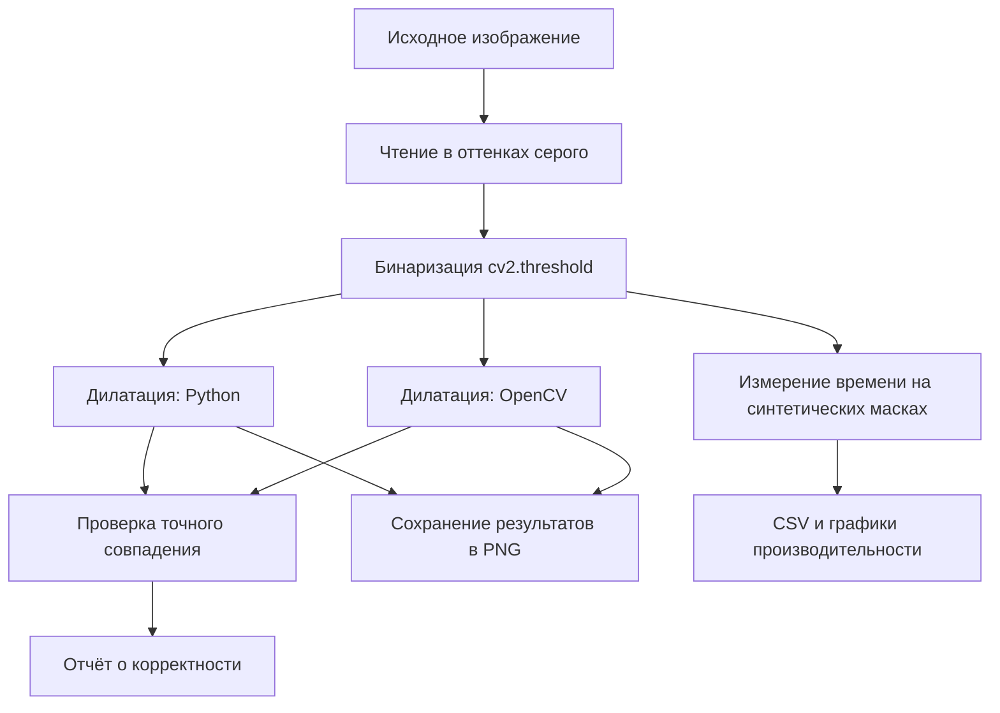
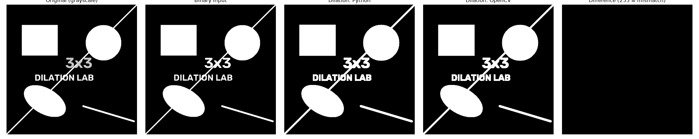
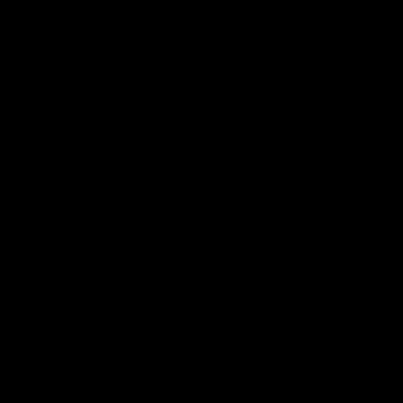
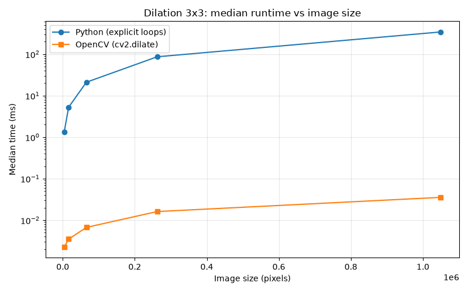
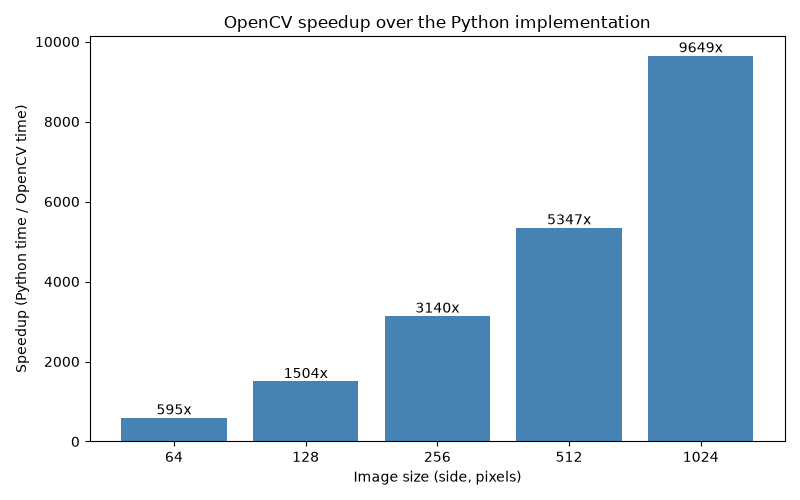

# Лабораторная работа № 1. Вариант 6 — дилатация 3×3

Реализация морфологической операции **дилатации** бинарного изображения с
структурирующим элементом 3×3 двумя способами — самостоятельно на Python и
с помощью библиотеки OpenCV — с проверкой их точного совпадения и
сравнением быстродействия.

## 1. Теоретическая база

**Дилатация** — операция математической морфологии, расширяющая белые
области (объекты) бинарного изображения. Для каждого пикселя результата
вычисляется максимум по окрестности, задаваемой структурирующим элементом:
если в окрестности 3×3 есть хотя бы один белый пиксель, результирующий
пиксель становится белым.

Обозначим входное бинарное изображение через $I$, а результат — через $D$.
Для координат $(x, y)$:

$$
D(x,y)=\max_{\Delta x,\Delta y\in\{-1,0,1\}}
I(x+\Delta x,\,y+\Delta y).
$$

**Структурирующий элемент** — квадратная матрица 3×3, все девять элементов
которой активны (включая диагональные соседи):

```text
1 1 1
1 1 1
1 1 1
```

Якорная позиция — центральный элемент (1, 1).

**Обработка границ.** Пиксели за пределами изображения считаются равными 0
(константное нулевое дополнение): при вычислении выходного пикселя на краю
или в углу проверяются только существующие позиции окрестности.

**Количество итераций — ровно одна.** Дилатация применяется к исходному
изображению один раз; результат не используется как вход для повторного
прохода.

Для бинарного случая (значения 0 и 255) операция эквивалентна логическому
«ИЛИ» по девяти позициям окрестности. Пример: одиночная белая точка в
центре 5×5 изображения превращается в белый квадрат 3×3, а точка в углу —
в блок 2×2, поскольку часть окрестности выходит за границу и считается
нулевой.

## 2. Описание разработанной системы

### 2.1. Структура проекта

```text
lab1/
├── README.md                  # данный отчёт
├── TASK.md                    # задание лабораторной работы
├── ARCHITECTURE.md            # проектное описание
├── pyproject.toml             # зависимости и настройки проекта
├── data/
│   └── example.png            # исходное изображение для демонстрации
├── src/dilation_lab/
│   ├── __init__.py            # публичный интерфейс пакета
│   ├── __main__.py            # входная точка: python -m dilation_lab
│   ├── io_utils.py            # загрузка, бинаризация, сохранение изображений
│   ├── dilation.py            # две реализации дилатации
│   ├── validation.py          # попиксельное сравнение результатов
│   ├── benchmark.py           # измерение времени, экспорт CSV
│   └── visualization.py       # составное изображение, графики
├── tests/
│   └── test_dilation.py       # автоматические тесты (pytest)
└── results/                   # получаемые файлы
    ├── demo/                  # результаты обработки example.png
    └── benchmark/             # benchmark.csv и графики
```

Классы не используются: достаточно обычных функций, разложенных по модулям.
Единственное исключение — dataclass `BenchmarkResult` в `benchmark.py`,
служит только контейнером результатов одного замера.

### 2.2. Поток данных



Обе реализации получают **один и тот же** бинарный массив `np.uint8`
(значения только 0 и 255). Чтение файлов, бинаризация, проверка и сохранение
выполняются OpenCV в обоих вариантах — это допускается условием задания:
самостоятельно реализована именно дилатация. В измеряемый интервал входят
только вызовы функций дилатации, включая создание выходного массива.

### 2.3. Две реализации и их различия

| | `dilate_python` | `dilate_opencv` |
|---|---|---|
| Механизм | Явные циклы Python: для каждого пикселя просматриваются до девяти позиций окрестности, с ранним выходом при нахождении белого пикселя | Один вызов `cv2.dilate` |
| Роль NumPy | Только формат хранения массива, без векторизации | Массив передаётся в библиотеку |
| Ядро | Офсеты `(-1, 0, 1)` по обеим осям | Константа `KERNEL_3X3 = np.ones((3, 3), np.uint8)`, созданная один раз на уровне модуля |
| Границы | Непосредственно за границей значение 0 (проверка индексов) | Явно заданы: `borderType=cv2.BORDER_CONSTANT`, `borderValue=0` |
| Итерации / якорь | 1 проход | `iterations=1`, `anchor=(1, 1)` |

Внутри `dilate_python` не используются `cv2.dilate`, свёртки и другие
готовые морфологические операции. Обе функции возвращают новый массив и не
изменяют входной.

### 2.4. Установка и запуск

Зависимости: `numpy`, `opencv-python-headless`, `matplotlib`; для тестов —
`pytest`.

```bash
python -m venv .venv
.venv/bin/pip install -e ".[dev]"
```

Команды запуска (из корня репозитория):

```bash
# Демонстрация: бинаризация, две дилатации, проверка, сохранение изображений
.venv/bin/python -m dilation_lab run \
  --input data/example.png \
  --output-dir results/demo \
  --threshold 127

# Измерение скорости на синтетических масках (15 запусков, 3 прогрева)
.venv/bin/python -m dilation_lab benchmark \
  --sizes 64 128 256 512 1024 \
  --runs 15 \
  --warmups 3 \
  --output-dir results/benchmark

# Автоматические тесты
.venv/bin/python -m pytest -q
```

Команда `run` сохраняет `input_binary.png`, `dilated_python.png`,
`dilated_opencv.png`, `difference.png`, `comparison.png` и завершается с
ненулевым кодом, если результаты реализаций различаются. Команда `benchmark`
записывает `benchmark.csv`, `benchmark.png` и `speedup.png`.

## 3. Результаты работы и тестирования

### 3.1. Демонстрация на изображении

Обе реализации применены к `data/example.png` (бинаризация с порогом 127).
Число несовпадающих пикселей: **0**.

Составное изображение (исходное, бинарный вход, результат Python, результат
OpenCV, маска различий):



Маска различий — полностью чёрная: ни один пиксель не отличается.



### 3.2. Сравнение быстродействия

Измерения выполнены на синтетических квадратных бинарных масках
(заполнение белыми пикселями 25%, фиксированный `seed=42`), по 15
измеряемых запусков и 3 прогрева на каждый размер и алгоритм. Время
фиксировалось через `time.perf_counter_ns()`. Поскольку одиночный вызов
OpenCV занимает менее 2 мс, для обоих алгоритмов на всех размерах применялся
пакетный замер: 5 вызовов в одном интервале, время серии делится на число
вызовов.

Окружение: Python 3.14.4, numpy 2.5.4, opencv-python-headless 5.0.0.93,
matplotlib 3.11.2, pytest 9.2.0; ОС Linux 7.0.0-38-generic (x86_64,
glibc 2.43); процессор AMD Ryzen AI 7 350 w/ Radeon 860M; OpenCV работал со
стандартными 16 потоками (`cv2.getNumThreads()=16`, потоки не фиксировались).

| Размер | Пикселей | Python, мс (медиана) | OpenCV, мс (медиана) | Ускорение OpenCV, раз |
|-------:|---------:|---------------------:|---------------------:|----------------------:|
| 64×64    | 4 096     | 1.340030  | 0.002252 | 595.04   |
| 128×128  | 16 384    | 5.269294  | 0.003502 | 1 504.65  |
| 256×256  | 65 536    | 21.046247 | 0.006703 | 3 139.83  |
| 512×512  | 262 144   | 86.395206 | 0.016156 | 5 347.56  |
| 1024×1024 | 1 048 576 | 342.213387 | 0.035464 | 9 649.60  |

Полные данные (медиана, минимум, межквартильный размах) — в
`results/benchmark/benchmark.csv`.

Зависимость медианного времени от размера изображения:



Коэффициент ускорения по размерам:



**Наблюдаемые закономерности.** Время Python-реализации растёт практически
линейно с числом пикселей: увеличение размера в 256 раз (64×64 → 1024×1024)
даёт рост времени в ≈255 раз (1.34 → 342.21 мс) — каждый пиксель
обрабатывается своим циклом. Время OpenCV тоже растёт, но существенно
сублинейно (в ≈16 раз на тех же 256 раз пикселей): на малых размерах оно
определяется фиксированными накладными расходами вызова, а на больших —
эффективной параллельной обработкой. Поэтому коэффициент ускорения
увеличивается с размером: от ≈595 раз на 64×64 до ≈9 650 раз на 1024×1024.

### 3.3. Автоматические тесты

```text
$ .venv/bin/python -m pytest -q
34 passed in 0.10s
```

Тесты покрывают: полностью чёрное и белое изображения, белую точку в
центре, углу и на стороне, диагональных соседей, изображения 1×1, узкие
матрицы 1×5 и 5×1, случайные бинарные маски (фиксированный `seed=42`) с
проверкой полного совпадения с OpenCV, неизменность входного массива,
тип и форму результата, работу функции сравнения (включая защиту от
переполнения `uint8` при вычислении разности) и валидацию порога
бинаризации.

## 4. Выводы по работе

1. **Корректность подтверждена.** На демонстрационном изображении и на всех
   тестовых масках число несовпадающих пикселей между реализациями равно
   **0**; все 34 тестовых случая пройдены. Обе реализации корректно
   обрабатывают границы (нулевое дополнение), диагональных соседей и
   вырожденные размеры (1×1, 1×N, N×1), не изменяя входной массив.

2. **Быстродействие.** На реальных измерениях OpenCV быстрее Python-реализации
   от ≈595 раз (64×64) до ≈9 650 раз (1024×1024). Python-версия на
   1024×1024 работает ≈342 мс, OpenCV — ≈0.035 мс.

3. **Причина различий.** Обе реализации вычисляют **одну и ту же**
   математическую операцию с одинаковым ядром, границами и числом итераций,
   поэтому сравниваются не два разных алгоритма, а два способа реализации:
   интерпретируемые циклы Python (попиксельный доступ к элементам массива
   через интерпретатор) и скомпилированный код библиотеки OpenCV на C++,
   оптимизированный и выполняемый в 16 потоках. Именно разница в уровне
   исполнения, а не в алгоритме, объясняет разрыв на три-четыре порядка
   величин.

4. **Ограничения сравнения.** Замеры выполнены на одной машине; OpenCV
   работал со стандартными 16 потоками (потоки не фиксировались, поэтому
   часть преимущества — за счёт параллелизма). Python-реализация намеренно
   не оптимизирована (явные циклы — требование задания), поэтому результат
   отражает «чистый» Python, а не лучший возможный вариант на нём. На
   субмиллисекунных временах OpenCV применил пакетный замер (5 вызовов на
   интервал), что сглаживает шум, но не устраняет его полностью. Маски
   синтетические (25% белых пикселей), что сопоставимо для обоих
   алгоритмов, но не обязательно типично для реальных изображений.

## 5. Использованные источники

1. Задание лабораторной работы № 1, вариант 6 (дилатация, примитив 3×3) — `TASK.md`.
2. OpenCV. Morphological Transformations (учебное пособие по морфологическим операциям). — https://docs.opencv.org/4.x/d9/d61/tutorial_py_morphological_ops.html
3. OpenCV. Image Filtering, функция `cv2.dilate` (параметры `anchor`, `iterations`, `borderType`, `borderValue`). — https://docs.opencv.org/4.x/d4/d86/group__imgproc__filter.html
4. Python. Модуль `time`, функция `time.perf_counter_ns()`. — https://docs.python.org/3/library/time.html#time.perf_counter_ns
